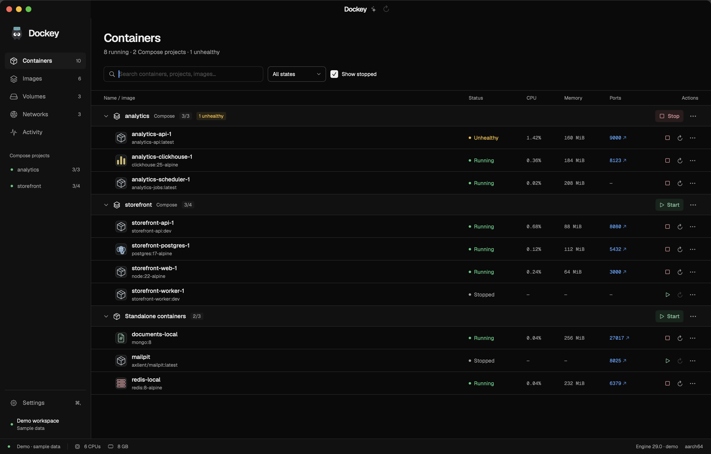
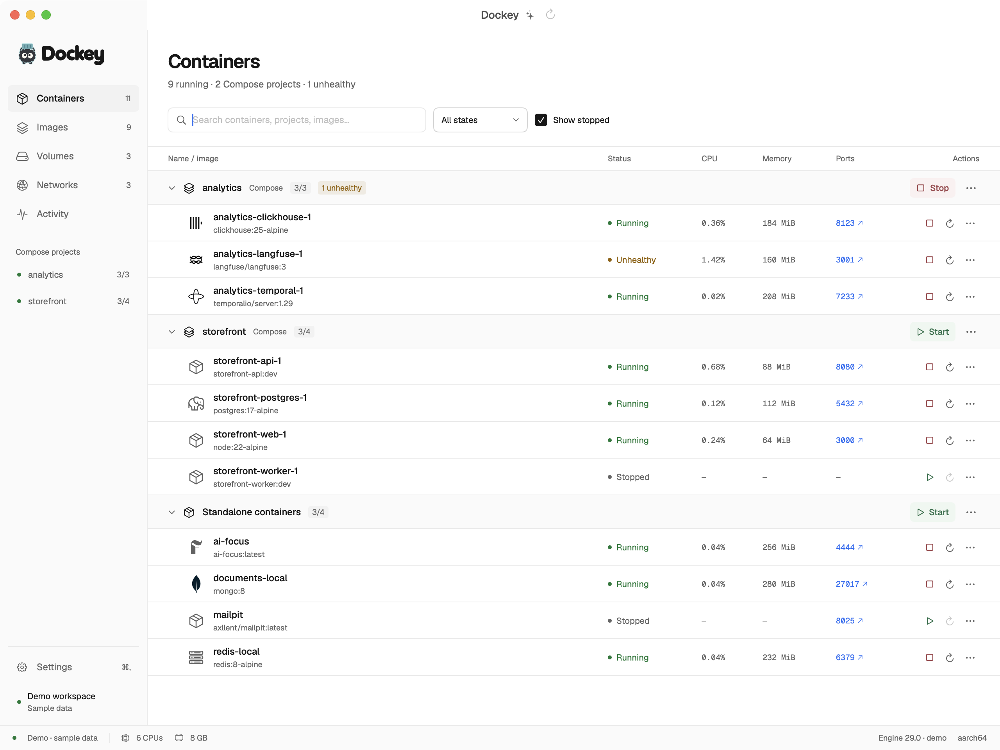

<p align="center">
  <picture>
    <source media="(prefers-color-scheme: dark)" srcset="docs/screenshots/dockey-brand-dark.png">
    
  </picture>
</p>

# Dockey

A native Mac app for the Docker Engine you already run. Dockey groups Compose containers, keeps everyday controls close, and makes logs and resource details easy to inspect.

[](https://github.com/cxkw-dev/dockey-ui/actions/workflows/ci.yml)
[](LICENSE)

Built with **SwiftUI and AppKit**. No Electron, browser server, account, or telemetry. Docker Desktop is not required. Dockey connects to an existing local Docker context, such as Colima; the runtime and CLI are installed separately.

<picture>
  <source media="(prefers-color-scheme: light)" srcset="docs/screenshots/dockey-light.png">
  
</picture>

*Native app screenshots use the built-in demo dataset. They contain no private host or container data.*

<details>
<summary>Light appearance</summary>



</details>

## What it does

| Workflow | Behavior |
| --- | --- |
| Find a project | Compose labels form expandable groups; standalone containers remain visible. Search and state filters narrow the list. |
| Control existing containers | Start, stop, and restart one container or a group, with pending state and specific operation results. Start is muted green; Stop is muted red. |
| Investigate a service | Follow bounded logs, inspect redacted configuration, and view ports, mounts, and current resource metrics. |
| Inspect local resources | Browse images, volumes, and networks without deleting them. |
| Find reclaimable space | The Storage view measures disk usage and lists dangling and unused images, stopped containers, unattached volumes, and idle build cache by size. It copies context-pinned `docker` commands for you to review and run; Dockey never removes anything itself. Named volumes have no bulk command. |
| Recognize services | Official monochrome ClickHouse, Langfuse, Temporal, and standalone MongoDB marks; AI Focus's F; Redis cache lines; and a Lucide elephant for PostgreSQL. Icons share a consistent layout with adjusted visual sizes. [Sources and licenses](docs/service-icons.md). |
| Choose a connection | Select a local Docker context within Dockey. The global Docker CLI context is unchanged. |
| Stay current | Docker events drive container updates; live metrics stream while visible. No repeating inventory polling. |
| Keep Dockey nearby | Closing its window hides it. Reopen from the Dock or menu bar; choose Quit to end the app. |
| Make it comfortable | System/light/dark appearance, compact/comfortable rows, log preferences, and stop confirmation. |

**This is an early native release.** Group controls operate on existing containers; they do not apply Compose files or promise dependency ordering. Container creation, deletion/prune, terminal sessions, remote engines, and runtime resource editing are outside this first release. [The feature inventory](docs/features-and-settings.md) records the broader design work.

## Install

Requirements: **macOS 14 or later**, an Apple Silicon or Intel Mac, and a working local Docker CLI/Engine connection. Building from source also needs **Swift 6 or later** from Apple's Command Line Tools or Xcode.

```sh
git clone https://github.com/cxkw-dev/dockey-ui.git
cd dockey-ui
./scripts/install.sh --open
```

This builds the app and installs it at **`~/Applications/Dockey.app`**, without `sudo`. It does not install or reconfigure Docker or Colima, switch your CLI context, or start any containers.

For packaged builds, choose the ZIP matching your Mac from [Releases](https://github.com/cxkw-dev/dockey-ui/releases), verify its SHA-256 file, and move `Dockey.app` to your Applications folder. Current ad-hoc-signed builds are **not Developer ID signed or notarized**; see [installation and Gatekeeper notes](docs/install.md) before choosing a downloaded build.

If you need a runtime, [Colima's getting-started guide](https://colima.run/docs/getting-started/) is one option. Dockey adopts your existing engine; it does not own the VM or its data.

## First launch

1. Start your existing local engine if it is stopped.
2. Open Dockey and select its local Docker context.
3. If Docker is not detected, choose its executable in **Settings → Connections**. Homebrew locations are detected without relying on a terminal's interactive shell configuration.
4. Open a container to inspect logs and details. Lifecycle changes happen only when you choose an action.

For an isolated visual tour, run the bundled demo mode:

```sh
open ~/Applications/Dockey.app --args --demo
```

Demo mode uses synthetic resources and simulated actions. It never connects to Docker. Quit the app before switching between demo and live launches.

The red close button or **⌘W** hides Dockey's window while the app keeps running. Click its Dock icon or choose **Show Dockey** from its menu bar item to reopen it. To quit, activate Dockey and press **⌘Q**, choose **Quit Dockey** from its menu bar item, or choose **Quit** from its Dock menu. Quitting leaves Docker and existing containers running.

## Uninstall

Quit Dockey with **⌘Q**, **Quit Dockey** from its menu bar item, or **Dock → Quit**, then move **`~/Applications/Dockey.app`** to the Trash. Closing the window only hides the running app and is insufficient for updating or uninstalling. To use the exact-path script instead:

```sh
./scripts/uninstall.sh --dry-run
./scripts/uninstall.sh
```

To also remove Dockey's preferences and its own Application Support directory:

```sh
./scripts/uninstall.sh --purge
```

The uninstaller checks the bundle identity and refuses unrelated apps or symbolic-link targets. Docker, Colima, contexts, containers, images, networks, volumes, and project files are preserved. [Full install/update/uninstall guide →](docs/install.md)

## Develop and verify

```sh
./scripts/check.sh
./scripts/build-app.sh
./scripts/check-app-launch.sh
open dist/Dockey.app --args --demo
```

`check.sh` runs the Swift Testing suite through `scripts/test.sh` and disposable installation/archive checks. The wrapper works with Command Line Tools installations that do not include XCTest and explicitly loads the selected toolchain's Swift Testing macro plugin when needed. The installer tests use an isolated signed fixture app, not your installed copy or Docker resources. CI runs on Apple Silicon and Intel macOS runners and produces app ZIPs and checksums.

`check-app-launch.sh` exercises temporary app copies with both flat SwiftPM and wrapped SwiftBuild resource bundles. Its default check rejects a missing font or service mark, verifies intact fonts, marks, and licenses, and exports a readable native demo PNG within a bounded timeout. Apple Silicon CI runs this full check. Intel CI explicitly uses `--resources-only`: both layouts must pass startup/resource verification and missing-font/mark rejection, but GUI rendering is not tested. The Intel hosted runner aborts during Metal rendering; physical Intel visual compatibility remains unverified. There is no automatic fallback, and neither mode connects to Docker. See [verification limits](docs/verification.md#compatibility-limits).

[Refresh performance and measured bottlenecks →](docs/performance.md)

The **Rounded 01** wordmark is editable project artwork, rendered as cached native vectors. The [branding guide](docs/branding.md) covers its source reference, SVG outline, and offline regeneration tools. No additional wordmark font or image is loaded by the app.

For an opt-in live integration check against your existing local engine:

```sh
./scripts/smoke-docker.sh --context YOUR_LOCAL_CONTEXT
```

This creates and removes one labelled Alpine test container, pulling `alpine:3` only if absent. The fixture has no mounts, published ports, or network access. Existing workloads are only read. See the [verification record](docs/verification.md) for the tested environment and evidence limits.

Run just the Swift suite, optionally filtering a focused area:

```sh
./scripts/test.sh
./scripts/test.sh --filter DockerParsingTests
```

```sh
./scripts/package-release.sh
```

The release script packages a built app into `dist/` and does not publish it. Pushing a version tag runs both architecture builds; only after both pass does CI verify the archives and publish a **prerelease** with the checked-in release notes. Native application verification, live Docker smoke testing, and automated fixture tests provide different evidence; none implies compatibility with every engine or runtime version.

## Project map

```text
Sources/Dockey/          SwiftUI/AppKit app, state, and bundled resources
Sources/DockeyCore/      Models, grouping, and Docker CLI integration
Tests/DockeyCoreTests/   Synthetic model/client/process tests
Tools/DockeySmoke/       Explicit live-integration probe for disposable fixtures
scripts/                Build, installation, removal, and packaging
docs/                   Architecture, guides, design decisions, screenshots
design-assets/          Mascot, original icons, and licensed vendor vector sources
prototypes/             Browser design studies retained as references
```

[Architecture](docs/architecture.md) · [Install guide](docs/install.md) · [Contributing](CONTRIBUTING.md) · [Security](SECURITY.md) · [Branding](docs/branding.md)

## License and acknowledgments

Dockey source is licensed under [Apache-2.0](LICENSE). Geist fonts retain their SIL Open Font License notices; vendor marks retain their upstream licenses and ownership. See [third-party notices](THIRD_PARTY_NOTICES.md).

The design adapts [Vercel's Geist design language](https://vercel.com/geist/introduction) for a native Mac utility, with Dockey's own mascot and identity. Dockey is an independent project and is not affiliated with Docker, Colima, or Vercel.
