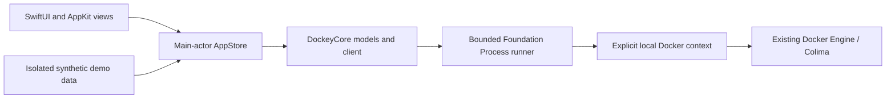

# Architecture

Dockey is a small native client for an independently managed local Docker Engine. It owns the application interface and preferences; the runtime owns the VM, daemon, container data, and restart policies.

## Boundaries

| Layer | Responsibility |
| --- | --- |
| `Sources/Dockey/Views` and `Design` | Native presentation, typography, controls, view-local interaction, accessibility labels, and appearance. |
| App state | Selection, preferences, refresh lifecycle, activity, pending operations, detail/log ownership, and demo/live routing. |
| `DockeyCore` | Typed resource models, Compose grouping, safe command planning, Docker output parsing, process lifetime, and operation reports. |
| Scripts | Create a self-contained `.app`, install/remove only that bundle, and produce verifiable archives. |

The package has no external Swift dependencies. The Docker CLI remains an external executable so Dockey can adopt a working engine connection without bundling or forking a runtime.

## Engine access

Commands use Foundation `Process` with executable URLs and argument arrays, never a shell command assembled from user input. Every engine operation supplies the app-selected context. Local Unix-socket contexts are the initial connection scope; a remote context is rejected before resource operations.

Process execution must drain stdout and stderr concurrently, bound output, respect timeouts, and terminate child processes on cancellation. The client returns per-container operation results so a successful action is not hidden by another container's failure.

Opening the app is read-only. Start, stop, and restart require explicit UI actions. The initial client exposes no generic shell executor, resource-removal API, prune operation, runtime-reset action, or implicit Compose-file execution.

## Grouping and operation semantics

Compose labels determine project and service ownership; a container's name is not enough. Group identity is scoped to the engine context. Standalone containers stay visible after Compose groups. Filters preserve the conceptual group hierarchy and do not rewrite Docker metadata.

A group action starts/stops/restarts the selected existing containers. It is a bulk lifecycle action, not `compose up`: it does not create missing services, apply configuration changes, or promise Compose dependency ordering. Runtime configuration and per-project configuration remain different future scopes.

## UI and asynchronous work

Views observe a main-actor store; Docker execution stays in the core actor/process layer. Pending IDs disable duplicate lifecycle actions. After initial discovery, a context-scoped Docker event stream drives state reconciliation instead of periodic inventory polling. A separate stats stream runs only while metrics are useful and the app is active. The store owns discovery, event, metric, and log tasks so selection changes, window closure, and cancellation can end old work rather than leaving a child process behind. [Live updates and performance](performance.md) describes the cache and reconnect behavior.

Logs have a bounded tail and session display buffer. Inspection is redacted before display/export, including environment values and sensitive fields. Redaction is a defense in depth measure, not a guarantee that arbitrary user logs are safe to publish. Logs are not uploaded or included in documentation captures.

The first settings surface contains functional application preferences. Runtime editing, terminal execution, resource deletion, and automatic updating are documented as later work rather than represented by inert controls.

## Demo mode and evidence

`--demo` is a separate source of synthetic data. It does not initialize a Docker connection and its lifecycle changes are simulated. Native documentation screenshots are generated in this mode so private resource names, logs, mounts, addresses, and host configuration cannot leak into the public repository.

Unit fixtures test parsing, grouping, command boundaries, error propagation, redaction, and cancellation. Installation tests use a disposable signed fixture bundle and temporary paths. Live smoke testing is a separate, explicit operation limited to resources named `dockey-smoke-*` with the `dev.dockey.smoke` label. A passing fixture suite does not prove a live engine was exercised.

`scripts/test.sh` selects Swift Testing without XCTest discovery. On Command Line Tools toolchains that need explicit macro registration, it discovers `libTestingMacros.dylib` from the selected `swiftc` target information and passes it to the compiler. It does not assume an Xcode installation path or download a testing dependency.

## Packaging

SwiftPM produces the executable and `Dockey_Dockey.bundle`. The build script places the executable in `Contents/MacOS` and the resource bundle in `Contents/Resources`. Packaged apps resolve that resource bundle explicitly from the installed app's standard Resources directory: SwiftPM-generated `Bundle.module` lookup differs between Xcode/native SwiftPM and Command Line Tools/SwiftBuild toolchains. Fonts, their license files, and app artwork remain inside the bundle.

`scripts/check-app-launch.sh` copies the signed app to an isolated temporary directory and tests both toolchain layouts: flat `Dockey_Dockey.bundle/Resources/Fonts` and wrapped `Dockey_Dockey.bundle/Contents/Resources/Resources/Fonts`. It transforms and re-signs only those disposable copies. For each layout, a negative check removes one font and requires explicit resource-verification failure, proving build-directory fallback cannot hide a broken app. Each intact copy must verify its bundled fonts and notices, launch in demo mode, exit within a timeout, and export a PNG that ImageIO can decode. CI runs both layouts on both Mac runners after building and before packaging. It never reads live Docker resources or replaces the user's installed copy. A filesystem-only regression also verifies conversion in both directions and rejects resource symlinks.

Local builds use an ad-hoc signature. A trusted downloaded release needs separate Developer ID signing and notarization; those require publisher credentials and are not implied by successful compilation or `codesign --verify`. ZIP checksums apply to the exact final archive.

Version tags run the same build/test matrix for Apple Silicon and Intel. A dependent, tag-only publishing job downloads the two successful artifacts, verifies checksums, and publishes a prerelease with versioned release notes. The default workflow permissions are read-only; only the publishing job receives repository-content write permission through GitHub's built-in token.
